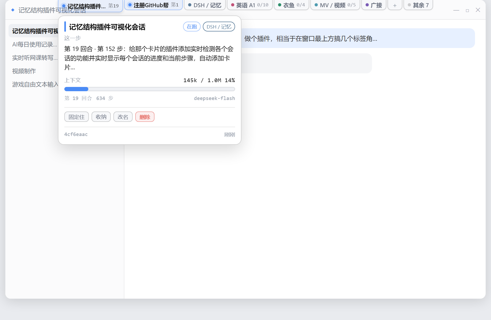
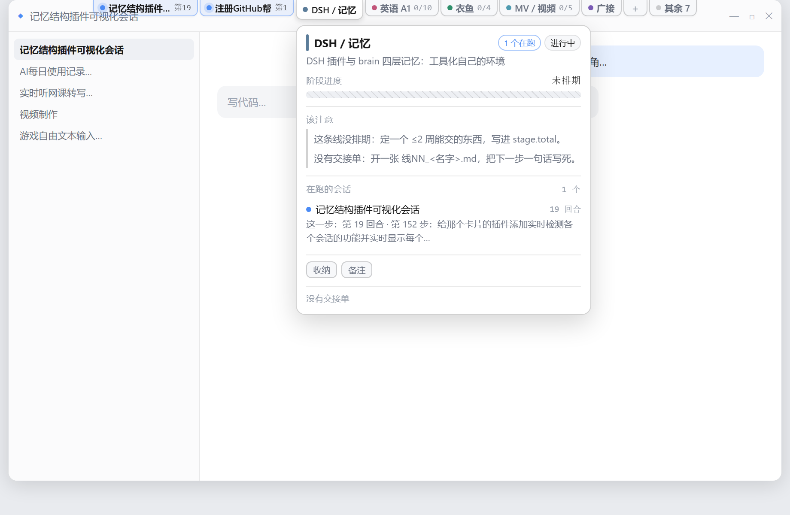
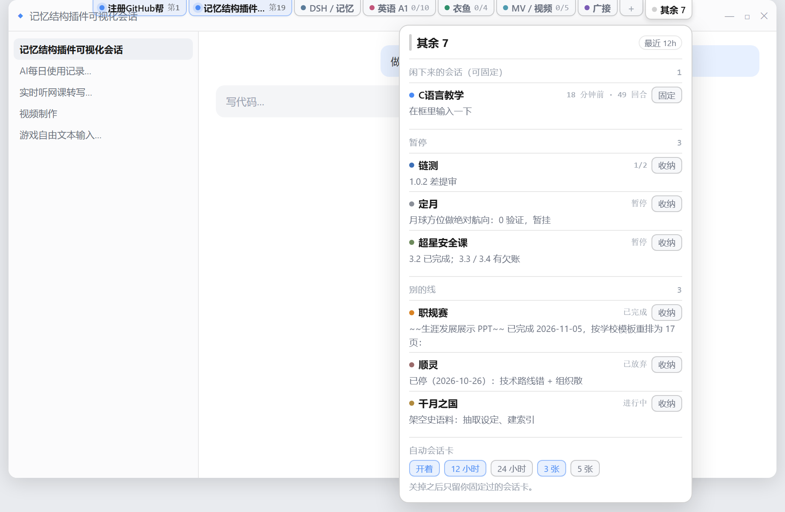

# dsh-project-tabs —— 窗口最上方的一排标签角

> **What it is (EN).** A DeepSeek Harness client plugin: a row of tabs hanging from the
> window's top edge. Hover one and a card drops down showing either a project line
> (progress bar, current step, what to watch out for), a **live session** (which turn /
> step it is on right now, context usage, model), or a card you wrote yourself. Sessions
> turn into cards automatically and vanish when they end; you can pin, shelf, rename,
> edit or delete any of them inline. Zero dependencies, hand-written bundle, no build step.



| | |
|---|---|
|  |  |

窗口顶边一排小角，一张角一样东西：**一条线**、**一个正在跑的会话**、或者**你自己加的一张卡**。
鼠标停上去往下掉一张卡；点一下钉住，再点或 Esc 收起（角移到卡上有 240ms 缓冲，不会中途收掉）。

三种卡长这样：

```
┌ 记忆结构插件可视化会话 ──────── [在跑] [DSH / 记忆] ┐   ← 会话卡：自动出现、自动消失
│ 第 19 回合 · 第 81 步：给那个卡片的插件添加实时检测… │
│ 上下文                        98k / 1.0M      10%  │
│ ▓▓▓░░░░░░░░░░░░░░░░░░░░░░░░░░░░░░░░░░░░░░░░░░░░░░  │
│ 第 19 回合   563 步              deepseek-flash      │
│ [固定住] [收纳] [改名] [删除]                        │
└─────────────────────────────────────────────────────┘

┌ 职规赛 ──────────────────── [已完成] ┐                ← 线卡：读交接单，人维护
│ 生涯发展展示：报告已定稿               │
│ 阶段进度                    0 / 8 页   │
│ ── 到这一步 ────────────────────────  │
│ 生涯发展展示 PPT（≤50MB，8 页）        │
│ ── 该注意 ──────────────────────────  │
│ 「展示 PPT 提交」还有 4d20h。          │
└────────────────────────────────────────┘

┌ 整理答辩稿 ─────────────────────────────┐              ← 手写卡：点条带末尾「+」加的
│ 周五前要交                             │
│ ● 写提纲   ● 配图                      │
│ [编辑] [收纳] [删除]                   │
└─────────────────────────────────────────┘
```

右边永远有：条带末尾的 **「+」**（加一张手写卡）、**「其余 N」**（闲下来的会话 / 暂停的线 /
别的线 / 自动会话卡开关）、**「收纳」**（收进去的卡都在这儿，能取回、能删）。

## 数据来自三层，各管各的

| 层 | 存在哪 | 谁改 | 频率 |
|---|---|---|---|
| **线** | `brain/journal/projects.json` + `brain/线NN_xxx.md` | 人（或者我写进交接单） | 慢 |
| **会话** | `~/.dsh/storages/session_projcache/sessions/session-<uuid>.json` | DSH 自己，每推进一步重写一次 | 秒级 |
| **你自己加的** | `brain/journal/cards.json` | 面板上点出来的 | 随时 |

**线卡**（字段来源）

| 卡上的东西 | 来源 |
|---|---|
| 线名 / 颜色 / 状态 / 一句话说明 | `projects.json` 的 `name` `color` `status` `brief` |
| **阶段进度 + 进度条** | `stage.done / stage.total / unit / note`（`total=0` 显示「未排期」，不假装有进度） |
| 截止 + 倒计时 | `deadlines[]` |
| **到这一步 / 后面还排着** | 交接单的 `**待做：**` 块；`——` 后面那半句当细化做法 |
| 卡在 | 交接单的 `**待定：**` |
| **在跑的会话** | 会话缓存里 `title / currentStep / turns`，按 `keywords` 归到线上 |
| 该注意 | `lib/projects.js` 的 `buildAdvice`，规则见下 |

**会话卡**（自动）

| 卡上的东西 | 缓存里的字段 |
|---|---|
| 标题 | `title` |
| **这一步** | `sessionStats.openStep` + `turnOutline.turns` 最后一条 → 「第 N 回合 · 第 M 步：prompt 首行」；没在步内就显示最后一句 prompt |
| **上下文占用条** | `contextPressure.pressureTokens / contextWindow` |
| 回合 / 步数 / 模型 | `sessionStats.turns` `steps`、`modelSelection.lastUsed.model` |
| 归到哪条线 | 会话标题 + 当前步骤 + 最后回答 里找 `projects.json` 的 `keywords`，命中取最长关键词 |
| 在跑 / 刚闲下来 | **缓存文件的 mtime** —— 120 秒内重写过就算在跑 |

会话卡会**自己出现、自己消失**：窗口内（默认 12 小时）有活动的会话才出现；关掉之后从条带消失，
除非你「固定」过它（固定 = 在 `cards.json` 里留一条，即使缓存过期也还在）。

**该注意的规则**（全在 `buildAdvice`，一眼能读完）：

| 条件 | 说一句 |
|---|---|
| 截止 <72h 且 `done === 0` | 还剩 X，一步没动 —— 这周只做这一件 |
| 截止 <72h 且已有进展 | 还剩 X，收尾优先 |
| 截止 <7d | 还有 X |
| `done >= total` | 这一步做完了 —— 去加下一件，别空转 |
| `total === 0` | 没排期：定一个 ≤2 周能交的东西 |
| `paused` 且没截止 | 停着：要么定日子，要么划掉 |
| 有 `**待定：**` | 卡在：…… |
| 3 天没改交接单 | N 天没碰交接单了 |
| 活跃但没有交接单 | 开一张 `线NN_<名字>.md`，把下一步一句话写死 |

**不做的事**：不推断进度（`done/total` 是人写的数字）、不猜哪些待做已经做完、
不替你改交接单。会话卡只读缓存，不读会话日志（那是多帧 zstd，解不动也没必要）。

## 标签怎么排

`maxLive`（默认 3）张会话卡 + `maxTabs`（默认 5）张线卡 + 手写卡，再加一个「其余 N」。

1. **在跑的会话**排最前（按最近活跃）；
2. **有会话在跑的线**紧跟其后（正在干活的那条线不该排到 5 张之外），再按最近截止升序；
3. 同档按「有排期 > 有交接单待做 > 都没有」，再按名字；
4. 闲下来的会话、暂停、已放弃、兜底的「其他」全部折进「其余 N」，分组列出来。

## 面板能做什么

| 动作 | 落在哪 |
|---|---|
| **+** 加一张卡（标题 / 备注 / 步骤） | `cards.json` 的 `cards[]` |
| 改名 / 写备注 / 编辑步骤 | 手写卡改本体；线和会话改名记在 `cards.json` 的 `projects{}` / `sessions{}` 覆盖层 |
| **固定住** 会话卡 | `sessions[<id>].pinned`，之后即使缓存过期也留着 |
| **收纳** | 任何卡都能收，收进去的进「收纳」那张卡，能取回、能删 |
| **删除** 线卡/会话卡 | 记一个 `hidden`，**不删** `projects.json` 里的线 |
| 自动会话卡开关 / 窗口 12h·24h / 3 张·5 张 | `cards.json` 的 `settings` |

`projects.json` **永远不会被面板改写** —— 所有人为操作都落在单独一个 `cards.json` 里，
写盘是「先 .bak、再 .tmp、最后 rename」，坏 JSON 读进来只报错、绝不覆盖。

## 装

```powershell
# 只装插件（会话卡 + 手写卡，不需要任何前置数据）
powershell -NoProfile -ExecutionPolicy Bypass -File dsh-project-tabs\install.ps1

# 同时也接上自己的项目线（projects.json 和交接单在哪就指哪）
powershell -NoProfile -ExecutionPolicy Bypass -File dsh-project-tabs\install.ps1 `
  -BrainDir "D:\my-brain"
```

复制到 profile 的 `plugins\` 与 `node_modules\`（同一路径重复载入会用旧模块缓存，所以每次整目录覆盖），
再把 `cordis.patch.yml` 缺的 `insert` 补上。`-Profile` 默认 `~\.dsh\profiles\desktop`。

**没有 `projects.json` 也能用**：那时没有线卡，只剩会话卡和手写卡，条带上会常驻一行灰字说明。
`brainDir` 指向的目录只要在 `journal\projects.json` 放一个数组就行，格式见下面的「配置」。

- **改了 `lib/client.js`**：刷新页面（Ctrl+R）就够。
- **改了 `index.js`**（host 半边）：要**重启 DSH**，因为它是启动时加载的。

## 卸

删 `cordis.patch.yml` 末尾那段 `- insert: ... name: 'dsh-project-tabs'`，删两个目录，刷新。
`brain/journal/cards.json` 是你的数据，留着不影响（删了只是自定义卡和收纳没了）。

## 配置

```yaml
- insert:
    - id: project-tabs
      name: 'dsh-project-tabs'
      config:
        brainDir: 'D:\my-brain'
        cacheDir: ''        # 空 = <DSH_HOME>\storages\session_projcache\sessions
        maxTabs: 5          # 线卡最多几张
        maxLive: 3          # 会话卡最多几张
        windowHours: 12     # 多久没动的会话就不再出现
        cacheMs: 2000       # 拼板缓存（面板每 3 秒拉一次）
```

`<brainDir>journalprojects.json` 是一个数组，最小一条长这样：

```json
[
  {
    "id": "site",
    "name": "官网改版",
    "color": "#4b8bf5",
    "status": "active",
    "brief": "一句话说清这条线在干什么",
    "keywords": ["官网", "landing", "首页"],
    "deadlines": [{ "at": "2026-12-01T18:00:00+08:00", "label": "上线" }],
    "stage": { "done": 2, "total": 6, "unit": "页", "note": "首页 / 关于" }
  }
]
```

`status` 取 `active` / `paused` / `done` / `dropped`；`keywords` 用来把会话归到这条线上。
`stage.total` 是 0 或缺失时显示「未排期」，不假装有进度。
「当前步骤 / 后面还排着」来自同目录的 `线NN_名字.md`，认 `**待做：**` 块下的 `- ` / `1. ` 条目，
`——` 后面那半句当细化做法；`**待定：**` 当卡点。

## 接口

```
GET  /project-tabs/api/ping                    # build / 目录是否存在
GET  /project-tabs/api/cards[?fresh=1]         # 标签、卡片、收纳、其余，一次拿全
POST /project-tabs/api/mutate                  # 唯一写入口，body 是 {op: ...}
```

`mutate` 的 op：`add` / `update` / `remove` / `flag`(`shelf|pinned|hidden`) / `rename` / `note` /
`meta`（一次改 title+note+steps）/ `settings`。

写入口有三道门：只收 `127.0.0.1`、拒绝 `sec-fetch-site: cross-site`、必须带 `x-project-tabs: 1`
且 `content-type: application/json`（body 上限 128KB）。跨源网页想发这个请求，得先过 preflight，
而 preflight 也会被挡下来。

会话里问：`project_tabs(action=lines | sessions | line, id=yiyu)`。

## 自检

```powershell
node dsh-project-tabs\test.mjs                    # 40 项：交接单解析 + 真实数据分组排序 + cards.json 增删改 + 会话缓存 + 拼板
node dsh-project-tabs\test\render-smoke.mjs       # 16 项：假 React 渲染四种卡，不越界不出 NaN
node dsh-project-tabs\test\http-check.mjs         # 12 项：假 ctx 起真 HTTP，GET/POST 全走一遍（写的是临时目录）
node dsh-project-tabs\test\visual.mjs <brainDir> <打开哪个角>   # 生成 test\visual.html
```

截图（`preview*.png` 就是这么来的，不需要 puppeteer）：

```powershell
& "C:\Program Files (x86)\Microsoft\Edge\Application\msedge.exe" --headless=new `
  --disable-gpu --hide-scrollbars --no-first-run --disable-extensions `
  --user-data-dir="$env:TEMP\edgeshot" --force-device-scale-factor=2 `
  --window-size=920,600 --virtual-time-budget=4000 `
  --screenshot=dsh-project-tabs\preview.png `
  "file:///<this repo>/test/visual.html"
```

`test\visual.html` 里另画了一条假标题栏，用来看标签角到底压在窗口的哪个位置。

## 已知边界

- 位置是**窗口顶边正中**。它压在标题栏上半部分（19–23px 高），条带本身点得穿，
  只有角和卡吃鼠标；但如果标题栏正中放着自己的控件，会被挡到，需要改 `S.strip` 的定位。
- 客户端每 3 秒拉一次 `/api/cards`（页面在后台时不拉）。会话卡因此**最多晚 3 秒**。
- 「在跑」是**靠缓存文件 mtime 猜的**，不是宿主告诉你状态。真停了但 120 秒内写过，会多显示一会儿。
- 只有 `projects.json` 里有的线才有线卡。会话归不到线时就是一张纯会话卡。
- 交接单里的「待做」只认 `- ` / `1. ` 开头的条目，认不出就当作没有，不猜。
- 手写卡的「步骤」只是勾选和文字，不带日期、不带提醒。
